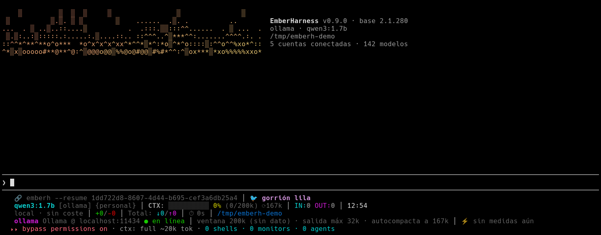
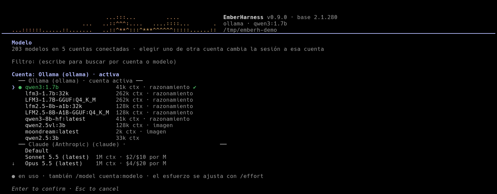
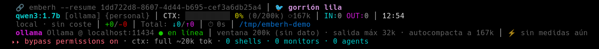

# EmberHarness

Arnés de agente para la terminal que funciona con cualquier proveedor de LLM. Herramientas,
subagentes, MCP, hooks y skills se comportan igual con Claude que con un modelo local en llama.cpp u
Ollama o con cualquier API compatible con OpenAI, y se puede cambiar de modelo y de cuenta a mitad de
una conversación.



> Uso interno. El proyecto parte de un snapshot reconstruido de Claude Code, así que el repositorio es
> privado y no se publica ni se redistribuye.

## Qué aporta

- **Cualquier proveedor.** Un adaptador traduce la API Messages de Anthropic a OpenAI Chat
  Completions (streaming, llamadas a herramientas, imágenes y razonamiento). Funciona con llama.cpp,
  Ollama, LM Studio, OpenAI, OpenRouter, Groq, DeepSeek, Gemini, Mistral, Together, Venice o
  cualquier endpoint compatible.
- **Varias cuentas a la vez.** `/model` lista los modelos de todas las cuentas conectadas; elegir uno
  de otra cuenta cambia la sesión a esa cuenta, y `cuenta:modelo` fuerza una cuenta para una sola
  petición o para un subagente.
- **Contexto a medida.** `/scope` y los perfiles (`--perfil`) deciden qué servidores MCP, skills y
  herramientas llegan al modelo, para que un modelo local con poca ventana no se ahogue.
- **Trabajo en segundo plano.** Cualquier herramienta, subagente o skill puede pasar a segundo plano
  (Ctrl+B), y las sesiones enteras se lanzan desacopladas con `/background`.
- **Configuración en JSON con recarga en caliente.** Cuentas, claves, modelos y tarifas se editan en
  ficheros JSON y se aplican sin reiniciar.
- **Barra de estado propia** con la ventana real del modelo, el coste, la velocidad del servidor local
  y el estado de la cuenta.



## Instalación

Requisitos: Linux, `git` y `bun` >= 1.3.11.

```bash
git clone https://github.com/gutierenmanuel/emberharness.git
cd emberharness
./install.sh
```

`install.sh` instala las dependencias, compila `./cli`, deja `ripgrep` listo para `Grep` y `Glob`
(usa el del sistema o descarga la release oficial con sha256 verificado, sin `sudo`) y enlaza el
comando `emberh` en `~/.local/bin`. Si esa carpeta no está en el `PATH`, el script lo avisa.

Primeros pasos: arranca `emberh` y entra con tu cuenta de Claude con `/login`, o añade otra cuenta
con `/account add <proveedor>` (proveedores del catálogo de models.dev, `/account catalog` los lista)
o `/account add <id> <baseUrl> [modelo]` para un servidor propio compatible con OpenAI.

## Uso

```bash
emberh                                  # sesión interactiva con la cuenta predeterminada
emberh --resume <session_id>            # retomar una sesión
emberh --account ollama                 # arrancar con otra cuenta (no se guarda)
emberh --account ollama --model qwen3:8b -p "resume este repo"   # una sola petición, sin TUI
emberh --perfil minimo                  # arrancar con un perfil de contexto
emberh --accounts                       # cuentas, la predeterminada y con cuál abrirá
emberh --set-default ollama qwen3:8b    # cuenta y modelo con los que abre (last = la última usada)
```

Comandos principales dentro de la sesión:

| Comando | Qué hace |
|---|---|
| `/account` | Cuentas con su estado (lista, falta la clave, servidor local apagado); `/account <id> [modelo]` cambia de cuenta |
| `/model` | Modelos de todas las cuentas conectadas; `cuenta:modelo` fuerza una cuenta |
| `/scope` | Qué llega al modelo: MCP, skills y herramientas, recordado por cuenta |
| `/perfil` | Aplica un perfil de contexto (`full`, `simple`, `minimo`, `chat` o uno propio) |
| `/goal`, `/loop` | Mantener al agente trabajando hasta cumplir una condición, o repetir una tarea |
| `/background <prompt>` | Sesión en segundo plano que continúa la conversación |

Las sesiones en segundo plano se gestionan desde fuera con `emberh ps`, `emberh logs <id> [-f]`,
`emberh attach <id>`, `emberh stop <id>` y `emberh rm <id>`. El catálogo completo de comandos está en
[docs/COMMANDS.md](docs/COMMANDS.md).

### Con qué cuenta abre

`--account` manda. Si no se pasa, se usa la cuenta predeterminada (`/account default <id> [modelo]`
o `emberh --set-default`) y, si no hay ninguna, la última usada. Cambiar de cuenta dentro de una
sesión no toca la predeterminada.

## Configuración

Todo vive en el directorio de configuración del arnés (`$CLAUDE_CONFIG_DIR`, que fija el lanzador
`bin/emberh`), separado de `~/.claude`. Los valores por defecto vienen en `src/config/defaults/`; tus
ficheros solo necesitan los campos que cambies y se recargan solos al guardarlos. Si un fichero queda
inválido se mantiene la última configuración buena.

| Fichero | Contenido |
|---|---|
| `accounts.json` | Cuentas (`model`, `smallModel`, `baseUrl`, `apiKeyRef`, `contextProfile`), la activa y la predeterminada |
| `providers.json` | Presets de proveedor (URL, variable de la clave, modelo por defecto, ventana) y, por modelo, ventana, tope de salida y tarifa |
| `claude-models.json` | Alias `sonnet`/`opus`/`haiku`, filas de `/model` y, por modelo, ventana, corte de conocimiento y tarifa |

Adoptar un modelo nuevo es una edición, por ejemplo en `claude-models.json`:

```json
{
  "aliases": { "sonnet": "claude-sonnet-6-0" },
  "models": {
    "claude-sonnet-6-0": { "tier": "sonnet", "version": "6.0", "apiId": "claude-sonnet-6-0",
                           "contextWindow": 1000000, "pricing": { "input": 3, "output": 15 } }
  }
}
```

La clave de una cuenta se busca en este orden: variable de entorno del proveedor, `apiKey` de la
cuenta, `apiKeyRef` de la cuenta, `keyRef` del proveedor y la plantilla `keyRefTemplate`
(`pass:apis/{provider}`). La ventana de contexto sale del servidor local si la informa; si no, de
`providers.json`, del preset y por último del catálogo de models.dev.

## Barra de estado



`statusline.sh` se registra sola en la primera ejecución y se refresca cada 2 segundos. Muestra el
modelo y la cuenta, el uso de la ventana real con el umbral de autocompactado, los tokens y el coste
de la sesión, y una línea con el estado de la cuenta: con un servidor local, si responde, su ventana
y la velocidad del último turno; con Claude, la ventana y los límites de 5 h y 7 días.

## Modelos locales

Con una cuenta local (`baseUrl` en `localhost`, `127.0.0.1` o `[::1]`) el arnés se adapta a ventanas
pequeñas y a un primer token lento:

- **Prompt ligero.** Arranca sin los `CLAUDE.md` del proyecto, sus reglas ni sus hooks (el
  `CLAUDE.md` global sí entra), recorta las descripciones de los parámetros de las herramientas y
  ordena el contexto estable antes de lo variable para aprovechar la caché del servidor. Pasar
  `--setting-sources` explícito lo anula.
- **Velocidad visible.** Bajo cada respuesta aparecen el tiempo hasta el primer token, la velocidad de
  lectura y de generación y, si el servidor la usa, la tasa de aciertos de la decodificación
  especulativa:

  ```
  ⚡ TTFT 0.42 s · lectura 1500 tok/s (300 tok, 2800 en caché) · generación 42.0 tok/s (210 tok) · especulación 75% (90/120)
  ```

- **Edición tolerante.** `Edit` sobre un archivo que el modelo no ha leído lo da por leído en vez de
  fallar; Claude y las cuentas remotas conservan la protección original.

## Búsqueda web

`WebSearch` y `WebFetch` nativas solo funcionan con la API de Anthropic y cuestan dinero con otros
proveedores, así que están desactivadas por defecto. En su lugar se usan las herramientas del
servidor MCP `web_search` (`mcp__web_search__web_search` y `mcp__web_search__web_fetch`).

## Estructura

| Ruta | Contenido |
|---|---|
| `src/` | Código del arnés: `commands/`, `tools/`, `screens/REPL.tsx` y el adaptador multiproveedor en `services/api/openai-compat/` |
| `bin/emberh` | Lanzador: fija el directorio de configuración, registra la barra de estado y pasa los argumentos al CLI |
| `statusline.sh` | Barra de estado |
| `scripts/` | Build (`build.ts`), versionado (`release.ts`) y un backend OpenAI falso para pruebas (`mock_openai.ts`) |
| `tests/e2e/` | Pruebas del binario real con backend falso y la TUI en un pseudoterminal |
| `lab/` | Laboratorio visual de la TUI con datos simulados |
| `docs/` | Comandos, guía de edición y planes de diseño |

## Desarrollo

```bash
bun install
bun run build         # genera ./cli
bun run test:unit     # pruebas unitarias
bun run test:e2e      # compila y conduce el ./cli real
bun run lab           # laboratorio de la TUI en http://127.0.0.1:7700
```

El trabajo va en ramas cortas (`quick/<slug>`) dentro de un worktree, con commits convencionales, y
se integra en `master` con `merge --no-ff` cuando pasan las pruebas; `master` siempre compila. Cómo
modificar el sistema: [docs/EDITING.md](docs/EDITING.md).

## Versiones

`package.json` lleva la versión propia (`version`) y la de Claude Code de la que parte
(`upstreamVersion`). Para publicar una versión: `bun run release patch|minor|major`, que sube la
versión, actualiza `CHANGELOG.md` y crea el tag.

## Más documentación

- [docs/COMMANDS.md](docs/COMMANDS.md): todos los comandos.
- [docs/EDITING.md](docs/EDITING.md): cómo está organizado el código y cómo cambiarlo.
- [docs/plans/ROADMAP.md](docs/plans/ROADMAP.md): mejoras previstas y su estado.
- [FEATURES.md](FEATURES.md): flags de compilación y funciones activadas.
